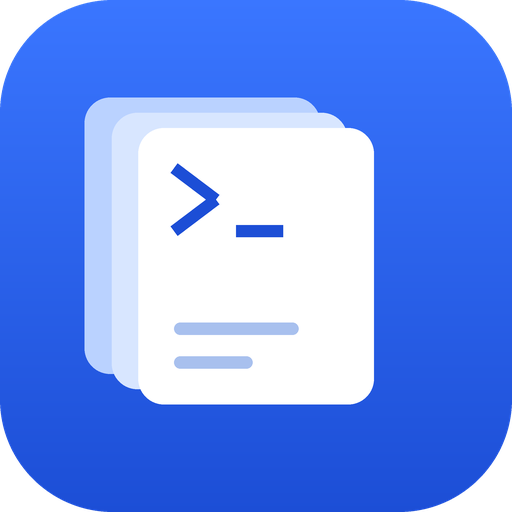

<p align="center">
  
</p>

# dsh-lark-cli-skills

[](https://www.npmjs.com/package/dsh-lark-cli-skills)
[](./LICENSE)
[](https://github.com/topics/dsh-plugin)

> A **DeepSeek Harness plugin** that brings the [Lark/Feishu CLI](https://github.com/larksuite/cli) agent skills into your DSH agent's catalog.

[Agent skills](https://github.com/larksuite/cli) for the Lark/Feishu CLI, packaged as a **DeepSeek Harness** plugin bundle.

Once installed, the DSH agent can consult and use **all 25** Lark/Feishu skills embedded in the CLI — Messenger, docs, Base, sheets, calendar, drive, tasks, wiki, approval, mail, slides, meetings, minutes, and more.

[中文文档](./README.zh.md)

## Complete mirror, nothing excluded

This package ships **every** skill the CLI embeds — a verbatim mirror of [`larksuite/cli`](https://github.com/larksuite/cli). Nothing is filtered out, so all inter-skill links work exactly as published upstream.

## Prerequisite

**`lark-cli` must be installed** — every skill documents its commands:

```bash
npm install -g @larksuite/cli
lark-cli --version
```

The skills are plain Markdown, but without the CLI their commands cannot run.

## Install

```bash
dsh plugin --profile <your-profile> add dsh-lark-cli-skills
```

Restart DSH afterwards; the skills appear in the agent's catalog.

## Included skills (25)

`lark-shared` (auth — required by all others), `lark-im`, `lark-doc`, `lark-sheets`, `lark-base`, `lark-calendar`, `lark-drive`, `lark-wiki`, `lark-task`, `lark-approval`, `lark-mail`, `lark-slides`, `lark-meeting`, `lark-note`, `lark-whiteboard`, `lark-okr`, `lark-contact`, `lark-attendance`, `lark-markdown`, `lark-event`, `lark-apps`, `lark-openapi-explorer`, `lark-skill-maker`, `lark-workflow-meeting-summary`, `lark-workflow-standup-report`.

The list is a **complete mirror** of what the installed CLI ships — nothing is filtered out, so every cross-skill link (`../<skill>/SKILL.md`) resolves.

## Updating the skill text

Skill text is **exported** from the locally installed `lark-cli` binary, never hand-written:

```bash
lark-cli update      # 1. upgrade the CLI
npm run sync         # 2. re-export
git add -A && git commit -m "chore: sync skills from lark-cli <version>"
npm version patch
npm publish
```

Detect a stale local copy:

```bash
npm run sync:check   # exits 1 when out of date
```

## Provenance and licensing

- **Skill text**: from [`@larksuite/cli`](https://github.com/larksuite/cli), **MIT License**, copyright Lark/Feishu. See [NOTICE](./NOTICE).
- **Plugin glue code** (`lib/`, `scripts/`, config): MIT License, copyright the authors of this repository.

This package does **not** modify upstream skill text (beyond writing it to files) and does **not** claim authorship of those skills.

## Privacy

Exported skills are **generic documentation** and contain no account data.

The sync script reads only the public output of `lark-cli skills list/read`; it never touches `~/.lark-cli/config.json`, credential storage, or any personal data.

## License

MIT. See [LICENSE](./LICENSE) and [NOTICE](./NOTICE).
