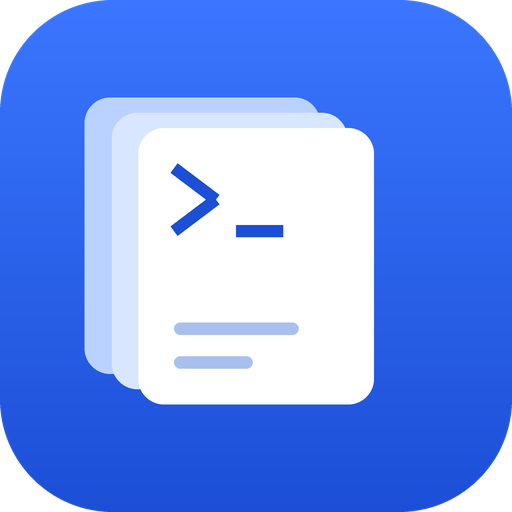

<p align="center">
  
</p>

# dsh-lark-cli-skills

[](https://www.npmjs.com/package/dsh-lark-cli-skills)
[](./LICENSE)
[](https://github.com/topics/dsh-plugin)

> 一个 **DeepSeek Harness 插件**，把 [飞书/Lark CLI](https://github.com/larksuite/cli) 的 agent 技能带入 DSH 的技能目录。

把 [lark-cli](https://github.com/larksuite/cli) 的 **agent skills** 打包成 DeepSeek Harness 插件。

安装后，DSH agent 就能直接查阅并使用 27 个飞书/Lark 技能——文档、多维表格、日历、云空间、任务、知识库、审批、邮箱、幻灯片、会议等。

## 为什么不包含 lark-im

本包**刻意排除** `lark-im`（即时通讯）技能。

原因：IM 通道通常由专门的桥接插件负责（例如 `@xmanrui/dsh-im`）。两者同时提供会造成功能重叠与指令冲突，所以这里只补充**非 IM** 的飞书能力，与 IM 插件**互补**而非重复。

如果你确实需要 lark-im 技能，直接从 `lark-cli skills read lark-im` 读取即可，或修改 `scripts/sync-skills.mjs` 里的 `EXCLUDED` 集合后重新同步。

## 前置条件

**必须先安装 `lark-cli`**，因为技能内容描述的都是它的命令：

```bash
npm install -g @larksuite/cli
lark-cli --version
```

技能本身只是 Markdown 文档，但不装 CLI 就无法执行里面的命令。

## 安装

```bash
dsh plugin --profile <your-profile> add dsh-lark-cli-skills
```

安装后重启 DSH，agent 的 skill catalog 里会出现 `lark-doc`、`lark-sheets`、`lark-base` 等技能。

## 包含的技能（27 个）

| 技能 | 用途 |
| --- | --- |
| `lark-shared` | 认证、身份切换、权限处理（**其他技能都依赖它**） |
| `lark-doc` | 飞书文档读写 |
| `lark-sheets` | 电子表格 |
| `lark-base` | 多维表格 |
| `lark-calendar` | 日历与会议室 |
| `lark-drive` | 云空间文件 |
| `lark-wiki` | 知识库 |
| `lark-task` | 任务与清单 |
| `lark-approval` | 审批 |
| `lark-mail` | 邮箱 |
| `lark-slides` | 幻灯片 |
| `lark-vc` / `lark-vc-agent` | 视频会议 |
| `lark-minutes` / `lark-meeting` / `lark-note` | 妙记与会议纪要 |
| `lark-whiteboard` | 白板 |
| `lark-okr` | OKR |
| `lark-contact` | 通讯录 |
| `lark-attendance` | 考勤 |
| `lark-markdown` | 云盘 Markdown |
| `lark-event` | 实时事件订阅 |
| `lark-apps` | 妙搭应用开发 |
| `lark-openapi-explorer` | 通用 OpenAPI 探索 |
| `lark-skill-maker` | 技能生成辅助 |
| `lark-workflow-*` | 会议总结 / 站会报告工作流 |

## 更新技能内容

技能内容是从本机 `lark-cli` 二进制里**导出**的，不是手写的。上游发新版后：

```bash
# 1. 升级 CLI
lark-cli update

# 2. 重新导出
npm run sync

# 3. 提交并发布
git add -A && git commit -m "chore: sync skills from lark-cli <version>"
npm version patch
npm publish
```

检查本地副本是否过期：

```bash
npm run sync:check   # 过期时退出码为 1
```

## 内容来源与许可

- **技能文本**：来自 [`@larksuite/cli`](https://github.com/larksuite/cli)，**MIT License**，版权归 Lark/Feishu 所有。见 [NOTICE](./NOTICE)。
- **插件胶水代码**（`lib/`、`scripts/`、配置）：MIT License，版权归本仓库作者所有。

本包**不修改**上游技能文本的内容（除导出为文件外），也不声称这些技能由本仓库原创。

## 隐私

导出的技能是**通用文档**，不包含任何使用者的账号信息。

同步脚本只读取 `lark-cli skills list/read` 的公开输出，不接触 `~/.lark-cli/config.json`、凭据存储或任何个人数据。

## License

MIT。详见 [LICENSE](./LICENSE) 与 [NOTICE](./NOTICE)。
